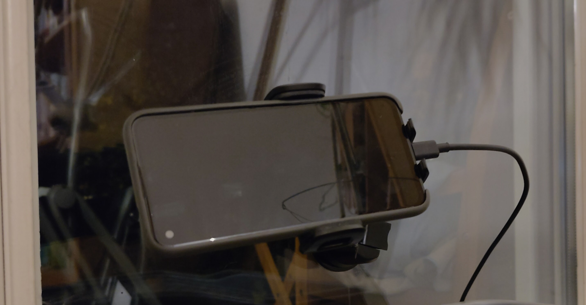
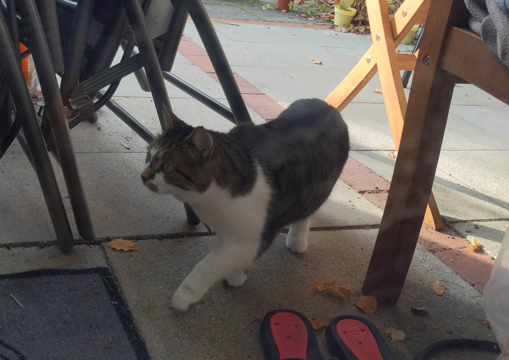

# Pawparazzi

Android app that watches the back camera with MediaPipe EfficientDet-Lite0, plays a sound for each newly
appearing cat or dog and saves a full-resolution photo to `Pictures/Pawparazzi/`.





## Build

```
./gradlew test                 # JVM unit tests (core:detection, core:settings, actions)
./gradlew :app:assembleDebug
./gradlew connectedAndroidTest # needs a device; camera tests need a real one
```

The detector model is fetched into `camera/src/main/assets/` by the `downloadModel` Gradle task on first build.

## Usage

Open the app, grant camera and notification permission, tap **Start**. Detection runs in a foreground service;
stop it from the app or the notification. There is no auto-start after reboot, and detection stays off after a
process death until started manually.

Photos are viewed in the phone's gallery. Older photos beyond the configured storage cap are deleted automatically
(only those saved by this installation).

## Keeping Pawparazzi alive

Android tends to aggressively stop background apps.
Check [dontkillmyapp.com](https://dontkillmyapp.com) for help.

## Heat

The app throttles analysis to 1 FPS at thermal status `SEVERE` and pauses the camera at `CRITICAL`.

## Licenses

See `LICENSE` and `NOTICE`. The same information is available in the app under Settings > Open source licenses.
