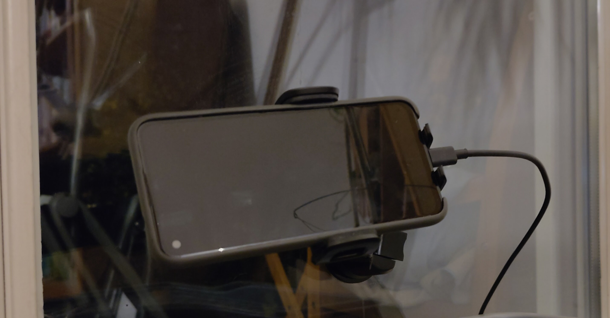
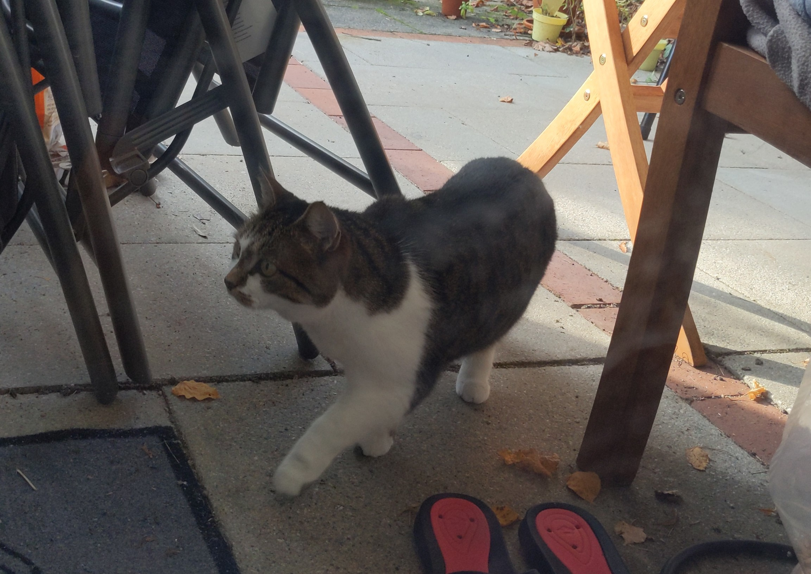

# Pawparazzi

Your very own pet paparazzo. Pawparazzi watches through your phone's camera, and whenever a cat or a dog shows up, it
plays a sound and takes a photo.





## What it does

- Spots cats and dogs in the camera view.
- Plays a sound for every animal that appears: one sound for cats, another for dogs. Use the built-in sounds or pick
  your own. Aim the phone at the door, and the sound becomes a doorbell for your pets: when you hear it, go and open
  the door.
- Saves a full-resolution photo to `Pictures/Pawparazzi/`, so you can browse the results in your gallery and see who
  visited and when.
- Keeps going while the screen is off, so an old phone on a charger makes a good, always-on pet camera.
- Cleans up after itself: when your photos exceed the storage limit you set, the oldest ones are deleted. Only photos
  taken by Pawparazzi are ever removed.

## Getting started

1. Install the app. Debug builds are attached to the
   [releases](https://github.com/mgropp/pawparazzi/releases) page.
2. Open it and allow camera and notification access. Detection starts as soon as the app is opened and has camera
   access.
3. Point the phone at the spot where your pets hang out.
4. Tap **Stop** in the app or in the notification when you are done. Tap **Start** to resume.

Notes:

- The phone must be in landscape orientation.
- The app does not start by itself after a reboot, or after Android has stopped it. Open it again to start detection.
- Make sure the media volume is up, otherwise you will not hear the sounds.
- Photos are not uploaded anywhere. Everything stays on the phone.

## Settings

Everything can be changed while the app is running:

- Sounds for cats and dogs
- How sure the app must be that it sees an animal
- How long to wait before the same animal triggers again
- How much storage the photos may use, and how much free space to keep
- Frame rate, and several finer detection settings

## Keeping Pawparazzi running

Android likes to stop background apps, and some phone makers are especially aggressive about it. If the app stops by
itself, check [dontkillmyapp.com](https://dontkillmyapp.com) for your phone, and exclude Pawparazzi from battery
optimization.

Running the camera for hours makes the phone warm. If it gets hot, the app slows down to one frame per second, and
pauses the camera completely if it gets hotter still. It resumes once the phone has cooled down.

## Licenses

See `LICENSE` and `NOTICE`. The same information is available in the app under Settings > Open source licenses.

---

# For developers

Pawparazzi detects animals with MediaPipe's EfficientDet-Lite0 model, entirely on the device.

## Requirements

- JDK 25
- Android SDK; the app supports Android 10 (API 29) and newer
- A real phone for anything involving the camera

## Build and test

```
./gradlew assembleDebug
./gradlew testDebugUnitTest           # JVM unit tests, also run by CI
./gradlew connectedDebugAndroidTest   # instrumented tests, need a device; camera tests need a real one
./gradlew spotlessApply               # format the code
```

The detector model is downloaded into `camera/src/main/assets/` by the `downloadModel` Gradle task on the first build.

Enable the repository's git hooks once per clone:

```
git config core.hooksPath .githooks
```

## Releases

Pushing a tag named `v-<version>` builds a debug APK and publishes it as a GitHub release.

## Project layout

| Module           | Contents                                                          |
|------------------|-------------------------------------------------------------------|
| `:app`           | Activity, Compose UI, foreground service, Hilt wiring             |
| `:core:detection`| Pure Kotlin tracking and trigger logic, no Android dependencies   |
| `:core:settings` | DataStore-backed settings and validation                          |
| `:camera`        | CameraX, MediaPipe wrapper                                        |
| `:actions`       | Sound playback, photo storage                                     |

Architecture rules, conventions and testing guidance are in [AGENTS.md](AGENTS.md).
